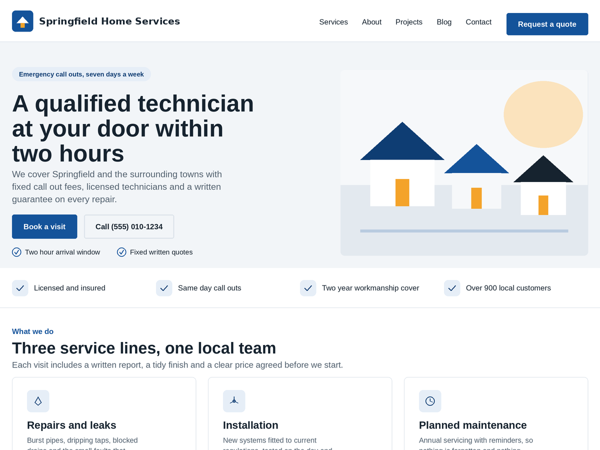

<h1 align="center">Servnora</h1>

<b>Block theme for home and local service businesses with 100+ patterns, ready pages and style variations.</b>

  
  

Free WordPress theme · Version 1.0.1 · GPLv2 or later

> [!NOTE]
> Servnora is officially distributed through **WordPress.org**. Please download, install and get updates from its [WordPress.org page](https://wordpress.org/themes/servnora/) so you always have the latest reviewed version.

## About

Servnora is a modern block theme for home and local service businesses such as plumbers, electricians, HVAC contractors, roofers, cleaners, landscapers, handymen, movers, painters and solar installers. It ships with a complete Full Site Editing setup: business focused templates, eight header and eight footer patterns, over one hundred conversion focused block patterns, ten complete ready made pages, eighteen industry starter layouts and twelve style variations. Everything is built with native Gutenberg blocks and theme.json design tokens, so you can build a trustworthy local business website from the Site Editor without writing code. The theme is responsive, RTL ready, translation ready, accessible and works with WooCommerce and popular form plugins.

## Requirements

- WordPress 6.6 or higher
- PHP 7.4 or higher

## How to install

1. In your WordPress dashboard go to **Appearance → Themes → Add New Theme**.
2. Search for **Servnora**.
3. Click **Install Now**, then **Activate**.

Or download it directly from **[WordPress.org](https://wordpress.org/themes/servnora/)**.

## Support

Questions or problems? Please use the **[support forum on WordPress.org](https://wordpress.org/support/theme/servnora/)**.

## Author

Developed by **[Muhammad Mujahid Sarfraz](https://profiles.wordpress.org/mujahidwp/)** · [All my WordPress products](https://profiles.wordpress.org/mujahidwp/) · [LinkedIn](https://www.linkedin.com/in/muhammad-mujahid-sarfraz-2631a43b6)
